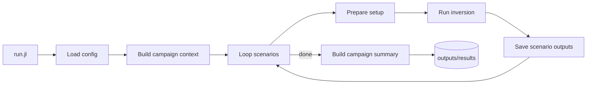

# Vendr.jl

A Julia package to orchestrate glacier inversion campaigns using the ODINN.jl ecosystem.

## Installation

Vendr uses local checkouts (`Pkg.develop`) of the ODINN ecosystem, pinned to these releases
(see `[compat]` in `Project.toml`):

| Package  | Version |
|----------|---------|
| ODINN    | v1.2.0  |
| Huginn   | v0.17.0 |
| Muninn   | v0.14.0 |
| Sleipnir | v0.17.1 |

```bash
cd ~/.julia/dev
for p in ODINN:v1.2.0 Huginn:v0.17.0 Muninn:v0.14.0 Sleipnir:v0.17.1; do
  git clone https://github.com/ODINN-SciML/${p%%:*}.jl ${p%%:*} && git -C ${p%%:*} switch --detach ${p##*:}
done
cd Vendr.jl
julia --project=. -e 'using Pkg; Pkg.develop([PackageSpec(path = joinpath("..", p)) for p in ("Sleipnir", "Muninn", "Huginn", "ODINN")]); Pkg.instantiate()'
```

### Previous setup

Results produced up to 2026-11-02 (`outputs/` folders dated before that) were obtained with
unreleased checkouts. The compat bounds of ODINN and Huginn were also edited locally to accept
Muninn 0.14 / Sleipnir 0.17:

| Package  | Commit    | Version in `Project.toml`   |
|----------|-----------|-----------------------------|
| ODINN    | `595ff18` | 1.1.0 (`dev` branch)        |
| Huginn   | `46b972c` | 0.16.0                      |
| Muninn   | `7cbcf94` | 0.14.0 (= v0.14.0)          |
| Sleipnir | `de6c4a9` | 0.17.0 (= v0.17.0)          |

## Quick Start

All campaigns use the **single `Project.toml` at the root** (`../../../`). You can run from either location:

### Option 1: From the campaign directory
```bash
cd inversions/02_synthetic/21_classic_no_reg
julia --project=../../../ run.jl
```

### Option 2: From Vendr.jl root
```bash
julia --project=. inversions/02_synthetic/21_classic_no_reg/run.jl
```

## Campaign Structure

Each campaign directory contains:
- `config/` - Configuration: `campaign.toml` and `scenarios.jl` (generates `scenarios.toml`)
- `data/` - Campaign-specific data
- `outputs/` - Results and logs
- `run.jl` - Main execution script

### Scenarios

`scenarios.toml` is not versioned: generate it before the first run with

```bash
julia inversions/02_synthetic/21_classic_no_reg/config/scenarios.jl
```

Each `[[scenarios]]` entry overrides the defaults below (all keys are optional):

```toml
[[scenarios]]
id = "S1"
loss_type = "HV"              # "H", "V" or "HV"
use_tim = false               # use the TI mass balance model
sparsity_H = true             # restrict H observations to the GlaThiDa mask
sparsity_V_sigma = 0.7        # V sparsity mask smoothing (0.0 = dense V)
sparsity_V_threshold = 0.02   # V sparsity mask threshold
regularization_weight = 3e37  # rheology regularization weight on A (0.0 = none)
# rgi_ids = ["RGI60-11.02773"] # override the campaign glaciers
```

### Compact Run Workflow



## Current Scope (v1)

- Inversion target: `A` (scalar)
- Data mode: synthetic ground truth
- Time mode: short non-transient setup (`2010:2011`)

## Main API

- `build_campaign_run_context(campaign_root)`
- `run_campaign!(context)`

## Next Steps

The code contains explicit `TODO:` comments for planned extensions:

- Trainable `C` (creep parameter) target
- Transient configuration (longer time periods)
- Observed-data mode (without synthetic ground truth generation)
- Target-aware metrics and plots (`A` vs `C`)
- Distributed `A` and field-based error analysis
